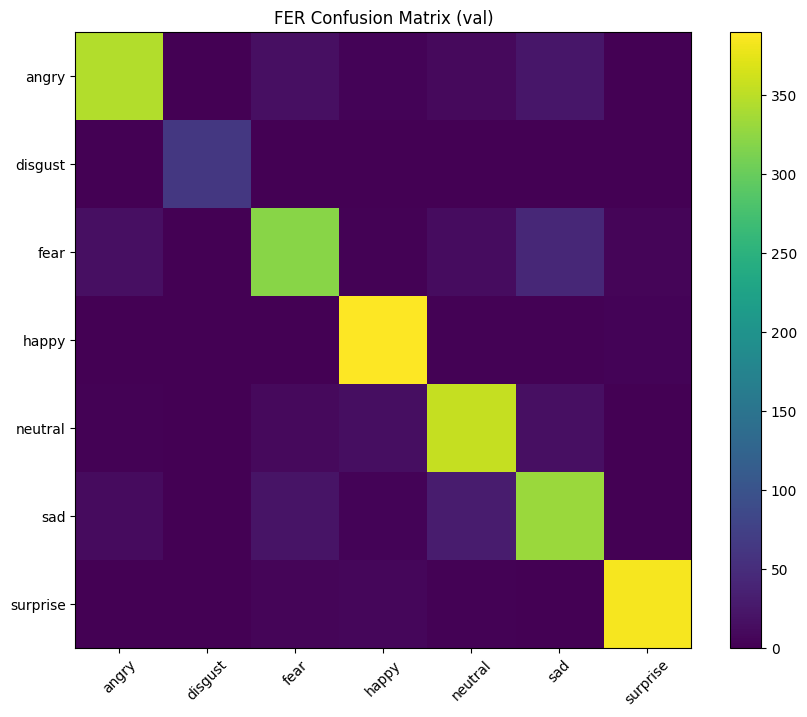
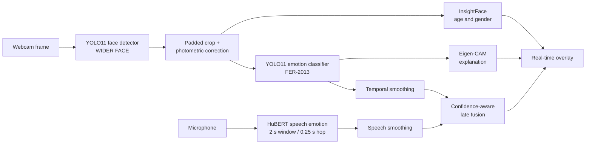

# Real-Time Multimodal Emotion Recognition with YOLO11


A deployment-oriented affective-computing pipeline that combines robust face localization, seven-class facial-expression recognition, speech emotion recognition, temporal stabilization, demographic context, and explainable AI.

The project is built around a two-stage visual pipeline: a YOLO11 detector trained on WIDER FACE localizes the face, and a YOLO11 classifier trained on FER-2013 predicts one of seven emotions. A HuBERT speech branch adds complementary audio evidence, while InsightFace and Eigen-CAM provide auxiliary demographic estimates and interpretable visual explanations.

## Results at a glance

| Metric | Saved evaluation result |
|---|---:|
| FER-2013 validation images | 2,465 |
| Top-1 accuracy | **88.8%** |
| Macro F1 | **0.899** |
| Weighted F1 | **0.888** |
| Strongest classes by F1 | Disgust 0.984, Surprise 0.964, Happy 0.949 |
| RAVDESS vision-only accuracy | **61.9%** |
| RAVDESS HuBERT accuracy | **48.0%** zero-shot, after prior correction |
| RAVDESS multimodal fusion accuracy | **66.7%** (**+4.8 percentage points** over vision-only) |
| Hardware used | NVIDIA RTX 3080 Laptop GPU |

The FER values come from the saved notebook run using single-crop inference. The notebook also records the larger Ultralytics validation result (`accuracy_top1 = 0.8922`) and full per-class precision/recall/F1. The RAVDESS results are reported in the revised paper; the accompanying evaluation notebook documents the reproducible protocol and fusion ablation workflow.



## What I built

- Converted FER-2013 into a YOLO classification layout and created reproducible train/validation splits.
- Trained a seven-class YOLO11 image classifier for angry, disgust, fear, happy, neutral, sad, and surprise.
- Used a WIDER FACE-trained YOLO11 detector to improve face localization under pose, scale, clutter, and occlusion.
- Added padded face crops and temporal probability averaging to reduce unstable labels and visible flicker.
- Added glare suppression, CLAHE, and adaptive gamma correction for difficult webcam lighting.
- Integrated HuBERT speech emotion recognition on a non-blocking sliding audio window.
- Added InsightFace age/gender estimates with temporal hysteresis so auxiliary labels do not oscillate frame to frame.
- Added Eigen-CAM overlays to expose image regions influencing the emotion classifier.
- Built an RAVDESS evaluation notebook for speech metrics and late-fusion ablation.
- Documented a reproducible resolution for an `ml_dtypes` / ONNX Runtime dependency conflict.

## Architecture



## Repository structure

```text
.
├── assets/
│   └── emotion_recognition_pipeline-01.png
├── notebooks/
│   ├── emotion_recognition_pipeline.ipynb
│   └── ravdess_multimodal_evaluation.ipynb
├── paper/
│   └── real-time-multimodal-emotion-recognition-v2.pdf
├── DATASETS.md
├── CITATION.cff
├── requirements.txt
└── README.md
```

Datasets, pretrained checkpoints, trained weights, and webcam captures are intentionally excluded. This keeps the repository reviewable, avoids redistributing third-party data, and prevents personal imagery from being published.

## Quick start

```bash
python -m venv .venv
# Windows
.venv\Scripts\activate
# macOS/Linux
source .venv/bin/activate

python -m pip install --upgrade pip
pip install -r requirements.txt
jupyter lab
```

Open `notebooks/emotion_recognition_pipeline.ipynb`, download the datasets described in [DATASETS.md](DATASETS.md), and place trained weights under:

```text
runs/detect/face_detector/weights/best.pt
runs/classify/fer_yolo_cls/weights/best.pt
```

The portfolio notebook uses repository-relative paths. Training a WIDER FACE detector and the FER classifier is GPU-intensive; the saved outputs document the completed FER evaluation.

## Evaluation design

The classifier evaluation caps each class at 400 examples, producing 2,465 samples because the `disgust` class contains 65 validation images. The strongest behavior is on happy, surprise, and disgust; the main error patterns are fear versus surprise and neutral versus sad, which are also known ambiguities in FER-2013.

The separate RAVDESS notebook evaluates:

1. HuBERT speech-only accuracy and macro-F1 over angry, happy, neutral, and sad.
2. Vision-only versus speech-only performance.
3. A fixed fusion-weight sweep.
4. Confidence-weighted dynamic fusion.

## Engineering decisions

- **Two-stage vision pipeline:** detection and classification can be trained and debugged independently.
- **Largest-face selection:** prioritizes a stable primary subject in the single-user webcam scenario.
- **Probability smoothing:** averages distributions rather than labels, retaining confidence information.
- **Periodic auxiliary inference:** demographic and explainability branches run less frequently to preserve interactive frame rates.
- **Dataset-free repository:** scripts and notebooks are public; data and model weights remain external with documented provenance.

## Responsible use and limitations

Emotion recognition does not reveal a person's internal mental state with certainty. FER-2013 is low-resolution, imbalanced, and contains noisy categorical labels. Speech performance degrades with background noise, while demographic estimators can inherit dataset bias. This prototype should not be used for diagnosis, surveillance, hiring decisions, or other high-stakes judgments about people.

## Paper

The accompanying revised paper, [Real-Time Multimodal Emotion Recognition with YOLO11](paper/real-time-multimodal-emotion-recognition-v2.pdf), describes the method, measured FER and multimodal-fusion results, system design, deployment trade-offs, and limitations in an IEEE-style format.

## Skills demonstrated

Computer vision, transfer learning, multimodal ML, real-time inference, dataset engineering, model evaluation, temporal smoothing, explainable AI, GPU deployment, dependency debugging, experiment design, and technical research writing.

